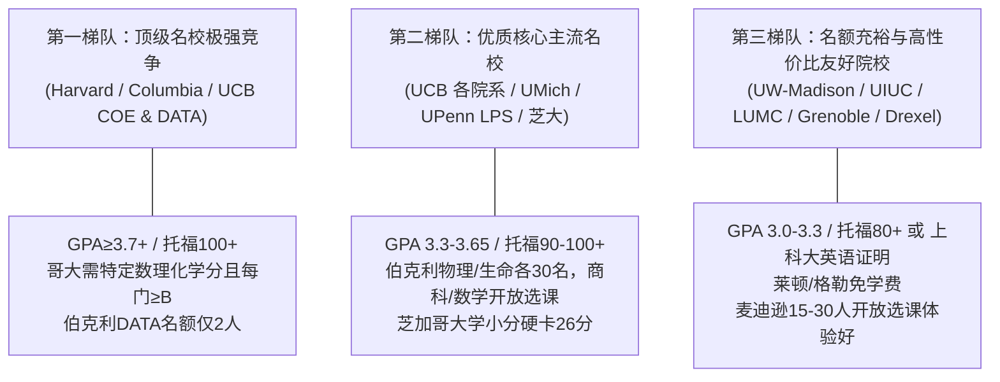

# 上海科技大学 3+1 本科国际交流项目与专项奖学金官方指南

> **数据基准**：
> 1. 《2026秋批次 3+1 项目信息参考大表》（教务处/国际合作处发布）
> 2. 《上海科技大学本科生国际交流专项奖学金评定管理办法》（上科大教〔2025〕2 号）

---

## 🌍 一、3+1 国际交流项目概览 (Overview)

“3+1”国际交流项目是上海科技大学高水平国际化创新人才培养体系的核心战略环节。学生在前三年完成校内核心通识、大类基础与专业主干课程后，于大三下学期或大四前往海外世界一流名校进行为期**一学期或一学年**的交流访学。

通过 3+1 项目，上科大学子不仅能直接在世界顶尖名校（如哈佛大学、加州大学伯克利分校、哥伦比亚大学、宾夕法尼亚大学、芝加哥大学等）修读前沿硬核高阶专业课程，更能深度参与世界顶级实验室的科研课题，获得国际知名学者的强力推荐信，为未来直博攻坚（PhD）、海内外深造与学术科研打下不可替代的坚实基石。

---

## 🏛️ 二、官方 19 项 3+1 合作高校与项目全矩阵

本批次共开放 **19 项官方合作项目**，涵盖美国、荷兰、法国三大主流访学目的地：

| 序号 | 合作高校与项目 | 所属院系 / Track | 申请名额 | 最低 GPA 门槛 | 往届录取学分绩参考 | 核心语言要求 | 基础学费参考 | 奖学金档位 |
| :---: | :--- | :--- | :---: | :---: | :---: | :--- | :--- | :---: |
| **1** | **哈佛大学** (Harvard) | Harvard College 本科生院 (VUS) | 3-5 名 | `GPA≥3.7` | `3.65 - 3.90` | 托福≥100 或 雅思≥7.0 | 约 $29,600/学期 (4门课) | **一类** |
| **2** | **加州大学伯克利分校** (UCB COE) | 工程学院项目 (EECS, MSE, BioE) | CS 10, EE 10, BioE 5, MSE 不限 | `GPA≥3.3` | `3.30 - 3.85` | 托福≥90 / 雅思≥7.0 (★可面试Waive) | 约 $21,900/学期 | **一类** |
| **3** | **加州大学伯克利分校** (UCB SCET) | 创新创业项目 (Venture Discovery) | 15 名 | `GPA≥3.0` | `New` | 托福≥90 / 雅思≥7.0 (★可面试Waive) | $21,900/学期 | **一类** |
| **4** | **加州大学伯克利分校** (UCB DATA) | 数据科学项目 (Globe Data) | 2 名 | `GPA≥3.3` | `3.40 - 3.65` | 托福≥90 / 雅思≥7.0 (★可面试Waive) | $21,900/学期 | **一类** |
| **5** | **加州大学伯克利分校** (UCB BICCEP) | 化学学院项目 (Chem & CBE) | 5 名 | `GPA≥3.0` | `3.20 - 3.79` | 托福≥90 / 雅思≥7.0 (★可面试Waive) | 约 $21,900/学期 | **一类** |
| **6** | **加州大学伯克利分校** (UCB BBSA) | 生命科学项目 (MCB & IB) | 30 名 | `GPA≥3.4` | `3.40 - 3.88` | 托福≥90 / 六级≥520 (★可面试Waive) | 约 $11,825 - $14,125/学期 | **三类** |
| **7** | **加州大学伯克利分校** (UCB BPIE) | 物理专业项目 (BPIE) | 30 名 | `GPA≥3.0` | `3.15 - 3.82` | 托福≥90 / 雅思≥7.0 (★可面试Waive) | 约 $21,900/学期 | **一类** |
| **8** | **加州大学伯克利分校** (UCB BHGAP) | 哈斯商学院项目 (BHGAP) | 暂无限制 | `GPA≥3.0` | `3.40 - 3.70` | 托福≥90 / 多邻国≥125 (★可面试Waive) | 约 $22,950/学期 | **一类** |
| **9** | **加州大学伯克利分校** (UCB BGA-Math) | 数学项目 (BGA Math) | 暂无限制 | `GPA≥3.0` | `3.10 - 3.90` | 托福≥90 / 多邻国≥125 (★可面试Waive) | 约 $15,900 - $21,900/学期 | **一类** |
| **10** | **加州大学伯克利分校** (UCB BGA-ID) | 工业设计通选 (BGA Design) | 暂无限制 | `GPA≥3.0` | `3.40 - 3.70` | 托福≥90 / 多邻国≥125 (★可面试Waive) | 约 $13,900 - $18,400/学期 | **一类** |
| **11** | **密歇根大学安娜堡分校** (UMich) | 文理学院 (LSA) | 5 名 | `原则上≥3.0` | `3.20 - 3.50` | 托福≥100 (听读23+说写21+) / 雅思≥7.0 (6.5+) | 约 $29,000 - $31,000/学期 | **一类** |
| **12** | **威斯康星大学麦迪逊分校** (UW-Madison) | VISP 访问生 (Traditional & Thematic) | 15-30 名 | `GPA≥3.0` | `3.05 - 3.85` | 雅思≥6.5 / **托福≥80** / 多邻国≥120 | 约 $16,700/学期 ($33,400/年) | **二类** |
| **13** | **伊利诺伊大学厄巴纳-香槟分校** (UIUC) | 文理学院 LAS Incoming Program | 15-30 名 | `GPA≥3.0` | `3.00 - 3.80` | **托福≥80** / 雅思≥6.5 / **上科大英语证明** | 约 $13,700/学期 | **三类** |
| **14** | **荷兰莱顿大学医学院** (LUMC) | Medicine & Biomedical Sciences | 3 名 | `GPA≥3.2` | `3.30 - 3.80` | 托福≥90 (不接受拼分) / 雅思≥6.5 | **免除学费 (Tuition-free)** | **五类** |
| **15** | **德雷塞尔大学** (Drexel) | 全学科对口院系 (CCI/工程/设计等) | 5 名 | `GPA≥3.0` | `3.00 - 3.65` | **托福≥80** / 雅思≥6.5 (J1签证) | 约 $20,614/学期 | **二类** |
| **16** | **芝加哥大学** (UChicago) | 各对口院系选课 (学季制 Quarter) | 3-5 名 | `GPA≥3.0` | `New` | **托福≥104 (小分26+)** / 雅思≥7.0 / 多邻国≥135 | 约 $23,775/学季 | **二类** |
| **17** | **哥伦比亚大学** (Columbia SEAS) | 工程学院 UVSP 访问生 | 约 3-5 名 | `GPA≥3.0` (理工课须B以上) | `3.90` | 托福≥100 / 雅思≥7.0 / 多邻国≥135 | 约 $34,000/学期 | **一类** |
| **18** | **法国格勒诺布尔综合理工** (Grenoble INP) | Ensimag / Pagora / Phelma 3 学院 | 5人/年 或 10人/学期 | `GPA≥3.0` | `3.10 - 3.70` | 托福≥75 / 雅思≥5.5 (B2等价) | **免除学费 (Tuition-free)** | **五类** |
| **19** | **宾夕法尼亚大学** (UPenn LPS) | 通识学院 IGSP (可跨选沃顿/工程) | 暂无限制 | `GPA≥3.3` | `New` | 托福≥100 / 雅思≥7.0 / 多邻国≥130 | $20,160 - $35,618/学期 (享10%优惠) | **一类** |

> 🌟 **【核心内幕·学长特快提点】加州大学伯克利分校（UC Berkeley）语言 Waiver 机制**：
> 很多同学误以为没有考出托福 90 分就无法申请伯克利 3+1。**实际上，Berkeley 的所有 3+1 项目并不严格要求英语标化成绩！**
> 若暂时没有托福/雅思/多邻国成绩，或者考试分数未达标，同学**完全可以通过参加 Berkeley 方面组织的远程线上英文面试（Online Interview），通过后由 Berkeley 直接开具官方英语能力证明，将语言成绩要求直接 Waive 掉！** 因而有志于前往伯克利的同学切勿因标化成绩尚未出分而放弃申报！

---

## 💰 三、上海科技大学国际交流专项奖学金评定政策

学校为支持优秀学子赴海外高水平大学交流，设立了完善的专项奖学金资助体系（依据《上海科技大学本科生国际交流专项奖学金评定管理办法》上科大教〔2025〕2 号）：

### 1. 参评资格与选拔机制
- **基本条件**：全日制在籍本科生、无违纪违规记录、品学兼优。
- **评定基准**：面向**完成学校 3+1 国际交流项目**、且**学生个人综合评价位于前 15%** 的优秀本科生。
- **频次限制**：学生在学期间**仅可获得一次** 3+1 专项奖学金。
- **评定时间**：原则上**每年 6 月集中开展**；学生在交流期结束后，必须按时提交**交流成绩单证明**与**项目小结**认定完成结项，方可参评。

### 2. 奖学金资助档位标准 (单位：万元人民币 / 学期)

| 项目类别 | 涵盖的高校与项目范围 | 前 2% 综合评价 | 前 3% - 7% 综合评价 | 前 8% - 15% 综合评价 |
| :---: | :--- | :---: | :---: | :---: |
| **一类** | 哈佛大学、MIT、耶鲁大学、宾夕法尼亚大学、康奈尔大学、**加州大学伯克利分校 (除BioScience)**、密歇根大学、哥伦比亚大学 | **8.3 万元** | **6.3 万元** | **5.0 万元** |
| **二类** | 百森商学院、威斯康辛大学麦迪逊分校、德雷塞尔大学、芝加哥大学 | **6.6 万元** | **5.0 万元** | **4.0 万元** |
| **三类** | 伊利诺伊大学厄巴纳-香槟分校 (UIUC)、加州大学伯克利分校 BioScience (BBSA) | **5.0 万元** | **3.8 万元** | **3.0 万元** |
| **四类** | 希伯来大学 | **3.3 万元** | **2.5 万元** | **2.0 万元** |
| **五类** | 荷兰莱顿大学医学院 (LUMC)、法国格勒诺布尔综合理工学院 (Grenoble INP) *(免学费项目)* | **1.7 万元** | **1.3 万元** | **1.0 万元** |

> 📌 **政策核心要点 (Important Notes)**：
> 1. **16 万元封顶原则**：原则上，学生在校期间获得国际交流专项奖学金（含 3+1、暑期课程、暑期科研等）总额**不超过人民币 16 万元**。
> 2. **家庭经济困难兜底**：学习成绩优异的家庭经济困难学生可申请高于基本奖励标准的资助，金额由学校学生奖惩委员会予以特殊审定。
> 3. **不重复资助**：若已由学校、学院、导师或外部资源资助，专项奖学金不重复资助；若外部资助少于对应专项奖学金标准，可酌情予以补足。

---

## 🧭 四、申请定位策略与专业匹配指导

根据历届录取数据与选拔特点，老学长将官方项目划分为三大梯队：

### 1. 专业方向适配速查
- **信息与计算 (CS / EE / AI / 计科 / 电子)**：
  - 加州大学伯克利分校 (COE CS/EE 专额 10人、DATA 2人)
  - 哥伦比亚大学工程学院 (SEAS UVSP，名校 Title + 顶级工程高阶课)
  - 威斯康星大学麦迪逊分校 (VISP Thematic CS Track，名额充足 15-30人)
  - 宾夕法尼亚大学 (LPS IGSP，可跨选工程学院高阶课)
  - 法国格勒诺布尔综合理工学院 (Ensimag 计算机与应用数学顶尖学院，免学费)
- **理学基础 (物理 / 化学 / 材料 / 数学)**：
  - 物理：加州大学伯克利分校 (BPIE 物理学院 30人，J1 签证进组方便)、芝加哥大学、UIUC
  - 化学/材料：加州大学伯克利分校 (BICCEP 化学学院 5人、COE MSE 不限名额)、UIUC
  - 数学：加州大学伯克利分校 (BGA-Math)、芝加哥大学、格勒诺布尔 Ensimag
- **生命与医学工程 (Life Science / BME)**：
  - 加州大学伯克利分校 (BBSA 30人，支持大学英语六级 CET-6≥520)
  - 荷兰莱顿大学医学院 (LUMC 3人，免学费，欧洲医学科研中心，支持带科研实习)
  - 加州大学伯克利分校 (COE BioE 5人)
- **工业设计与商科交叉 (Design / Business)**：
  - 工业设计：加州大学伯克利分校 (BGA-ID 暂无名额限制)、密歇根大学 (LSA)、德雷塞尔 (需作品集)
  - 商科创投：加州大学伯克利分校 (BHGAP 哈斯商学院、SCET 创新创业 15人)、宾大 (LPS 跨选沃顿商学院)

---

## 📅 五、关键申报流程与时间线 (Timeline)

1. **大三上学期 10 - 12 月（语言标化与意向准备）**：
   - 考取达标的托福（TOEFL）、雅思（IELTS）或多邻国（Duolingo）成绩。
   - 梳理前五个学期绩点与学分完成情况，确保核心通识与专业基础必修全部修完。
2. **大三上学期 12 月 - 1 月初（校内申报与初选）**：
   - **校内申请截止日：通常为 1 月 5 日前后**。
   - 在上科大国际交流系统提交志愿申报与成绩单。
3. **大三下学期 2 - 4 月（学校提名与外方网申）**：
   - 学校组织外事评审与正式提名（如伯克利网上面试、哥大提名）。
   - 学生根据外方大学系统指引完成网申（提交 PS、推荐信、官方成绩单、财产证明）。
   - 外方陆续发放 Official Admission Letter 与 I-20 / DS-2019 表格。
4. **大三下学期 5 - 7 月（签证办理与选课指导）**：
   - 办理赴美 F1/J1 签证或欧洲学生居留签证。
   - 提前查阅外方选课手册，并在上科大教务系统完成学籍异动报备。
5. **大四阶段（海外访学修课、毕业设计与学分回国认定）**：
   - 严格按照外方全日制要求修读规定学分（通常 12-18 学分/学期）。
   - 毕业设计（SI199 6学分）需与校内指导老师保持紧密沟通，按时提交开题、中期检查并安排答辩。
   - 交流结束后提交成绩单认定学分，并在次年 6 月申请国际交流专项奖学金。

---

## 💡 六、CLI 工具与数据查询速查

老学长助手已将所有 3+1 官方数据与奖学金算法封装进 CLI，随时随地直接调取：

| 功能 | 命令示例 | 说明 |
| :--- | :--- | :--- |
| **查询所有项目** | `python3 scripts/senior.py 3plus1` | 列出 19 项合作项目总表 |
| **按专业筛选** | `python3 scripts/senior.py 3plus1 --major 计算机` | 筛选对口计算机/电子/物理等的项目 |
| **按奖学金档位** | `python3 scripts/senior.py 3plus1 --tier 一类` | 查看所有一类奖学金项目 |
| **查特定高校档案** | `python3 scripts/senior.py 3plus1 info 伯克利` | 输出伯克利各学院详细名额、学费、选课与链接 |
| **智能背景定位匹配** | `python3 scripts/senior.py 3plus1 match --gpa 3.65 --toefl 102 --major 计算机` | 自动划分为核心适配、保底充裕、冲刺拔高与受限项 |
| **查询官方奖学金政策** | `python3 scripts/senior.py 3plus1 scholarship` | 查看一类至五类资助金额与综合评价 15% 细则 |
| **查看申报截止时间轴** | `python3 scripts/senior.py 3plus1 deadlines` | 输出校内截止、外方截止与开学周一览表 |
| **对话直接把脉** | `python3 scripts/senior.py ask "我想了解伯克利3+1"` | 智能感知并输出对应高校深度分析 |
